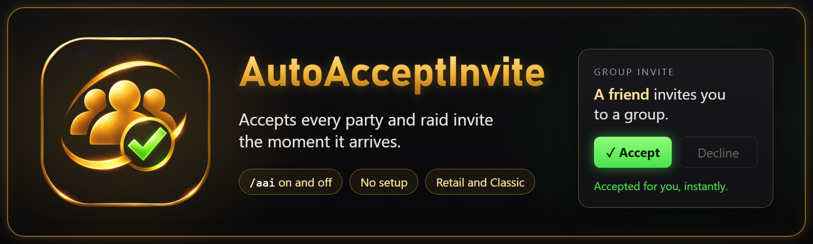

**AutoAcceptInvite** accepts group invites the moment they arrive, and queues for you. When your group's leader queues, or when you sign up for a group yourself, the game asks which role you want. This addon answers for you, as the right role. There is nothing to set up: it works as soon as it is installed.

## What it does

- **Accepts invites at once.** From everyone, or only from your friends and guild members.
- **Protects your queue.** An invite that would take you out of a queue is left for you to answer, the same cases where the game's own popup warns you.
- **Queues for you.** It answers the role check when your group's leader queues for a dungeon, raid or battleground, or signs the group up for a premade group.
- **Signs you up with a double-click.** Double-click a group in the LFG list and you are signed up, with no second window to confirm. Hold Shift to see the window and write a note.
- **Picks the right role.** Your current specialization's role by default, or always Tank, Healer or Damage. Each character remembers its own choice.
- **Tells you what it did.** One line in chat each time, and the first one says how to change it.

## Options

Open **Esc > Options > AddOns > AutoAcceptInvite**, or type `/aai options`. Everything is on from the start, and each part can be switched off.

- **Auto-accept invites**
  - **Not while I'm in a queue**: leaves an invite for you when accepting it would end your queue.
  - **From**: everyone, friends and guild members, friends only, or guild members only. Friends means your friends list and your Battle.net friends.
- **Automatically queue for me**
  - **Queue as**: my current specialization's role, Tank, Healer or Damage. Kept per character.
- **Print a chat message when something is accepted**
- **Double-click a group in the LFG list to sign up for it**

## Commands

- `/aai` turns auto-accepting invites on or off. `/aai on` and `/aai off` work too.
- `/aai queue` turns queueing for you on or off.
- `/aai options` opens the options.

## Good to know

- It does not press **Enter Dungeon** when the queue pops. The game only lets a player do that.
- If the game does not take the role, for example Tank on a class that cannot tank, the addon does not answer. The window stays open for you, and chat says so.
- Queueing from the Dungeon Finder yourself is unchanged: there you tick your role and click, as always.
- An invite from someone your "From" choice leaves out gets the normal popup.

## Game versions

- **Retail and Mists of Pandaria Classic**: invites and queueing. The double-click checkbox shows wherever the game has the LFG list.
- **Classic Era, Burning Crusade Classic Anniversary and Forever**: these have no group finder, so the addon accepts invites, with the friends and guild choice, and shows nothing about queues.

## Feedback

Found a problem or have an idea? Open an issue on [GitHub](https://github.com/steven-rr/auto-accept-invite/issues).
